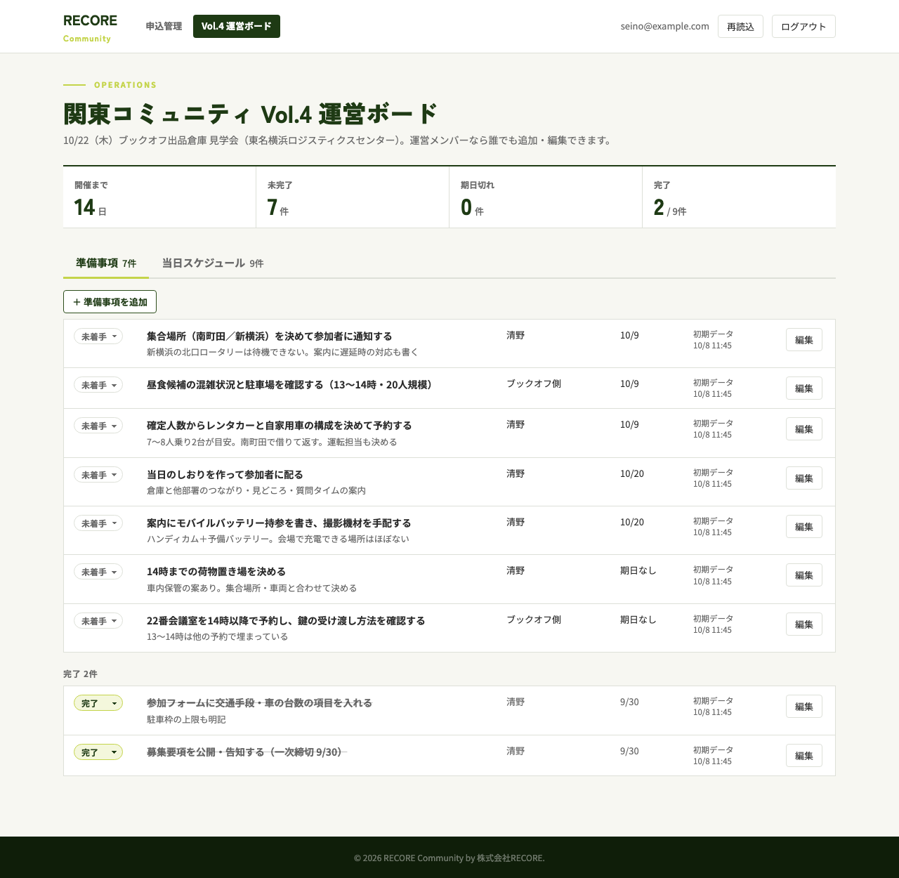
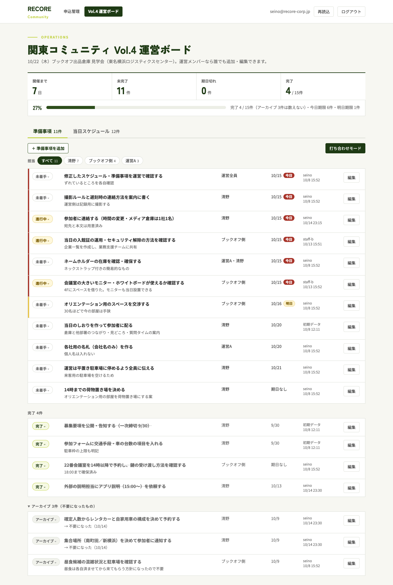
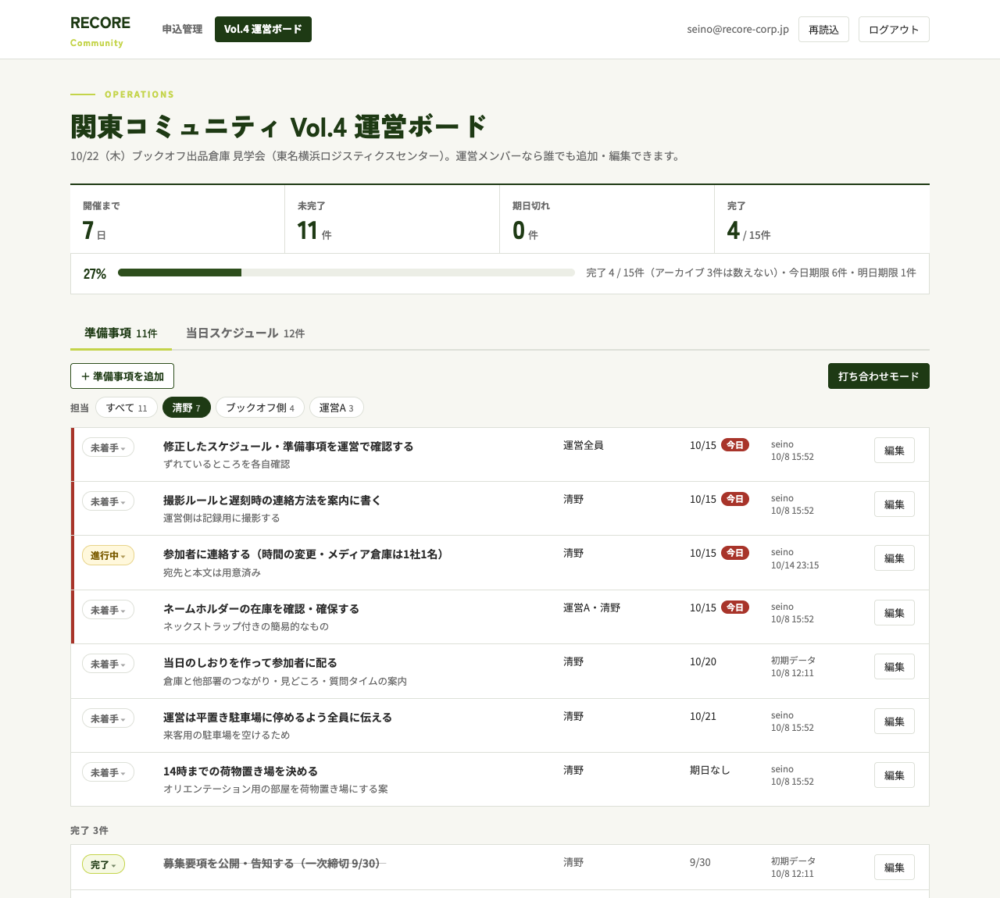
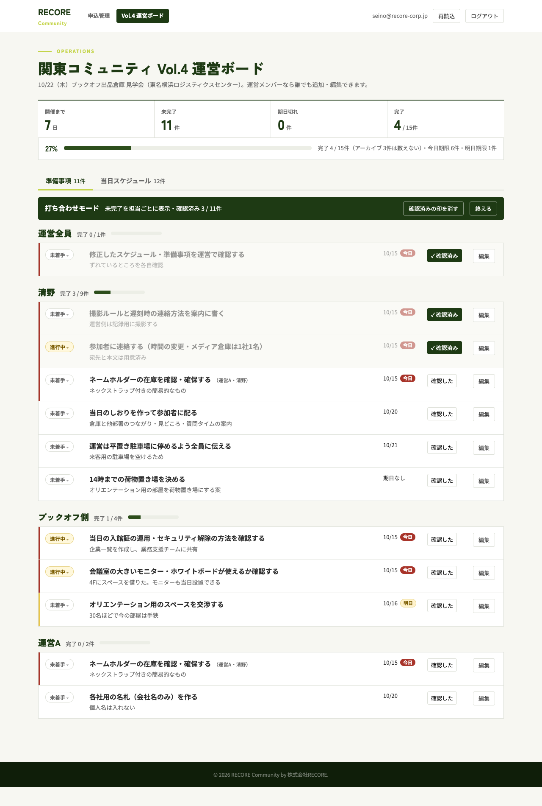

# 運営ボードの進捗管理（担当の絞り込み・アーカイブ・進捗率・打ち合わせモード）

状態: 確定
出典: 清野さん 2026-10-14「運営ボードのタスクの進捗管理したい」「終わったらボードに機能を足したい」（選んだ機能：担当者で絞り込む・不要→アーカイブ・進捗率バーと期限の近いものの強調・打ち合わせ用の確認モード）
前提の設計: `docs/designs/2026-10-08-ops-board/design.md`（以下「前回」。D1〜D12 はそのまま）
更新: 2026-10-14

## 課題

関東 Vol.4（10/22）の準備事項は21件、担当は社内・社外の5名と「運営全員」に分かれている。10/14 に進捗を直したとき、次の3つで困った。

- 不要になったタスク（レンタカー・集合場所の通知・南町田のピックアップ、10/8 の昼食）は、メモに「不要」と書いて完了にするしかない。完了の件数が実際に終えた数より多く出る
- 自分の分だけを見る手段がない。担当が「運営Aさん・清野」のように複数のこともあり、21件を目で探す
- 運営の打ち合わせ（10/15 の最終すり合わせなど）では、画面共有して担当ごとに「どこまで進んだか」を聞いていく。いまの一覧は期日順なので、担当ごとに話すと画面を上下に行き来し、どれを話し終えたかも分からない

## 解決した状態

- 不要になったタスクはアーカイブに移り、完了とは分かれて、進捗率の分母から外れる
- 運営の誰もが、担当を1つ押せば自分の未完了だけを見られる。今日・明日が期限のものが目立つ
- 打ち合わせでは「打ち合わせモード」で、担当ごとに未完了を並べて上から順に聞き、話した行に印を付けながら、その場で状態を直せる

## 主なコンテキスト

フロントエンド。理由：4つの要望のうち3つは見せ方の変更で、データは変えない。アーカイブだけ、状態の取りうる値を1つ足す（従）。

## 設計の意図

守るもの：**準備の進み具合が、実際に終えた数のとおりに見えること。** 打ち合わせの場でも、運営の誰がいつ開いても同じ数字になる。

| # | 決めたこと | 意図 | 選ばなかった案 |
|---|---|---|---|
| D1 | アーカイブは状態の4つ目「アーカイブ」として持つ。状態のプルダウンで移し、戻すのも同じ操作（清野さんの判断） | 不要になったタスクは、未着手・進行中・完了のどれでもない。状態を1つに保てば「完了かつアーカイブ」のような迷う組み合わせができない。前回 D6 のワンタップ変更がそのまま使える | → 状態とは別にアーカイブの印を持つ：操作が1つ増え、組み合わせの意味を決める必要が出る／→ 削除：なぜ不要になったかが残らない |
| D2 | アーカイブは一覧の一番下に「アーカイブ n件（不要になったもの）」として畳んで出す。進捗率・完了・未完了・期日切れ・タブの件数のどれにも数えない | 不要なものが進捗の数字を動かさない。畳んでおけば普段の一覧の邪魔にならず、開けば理由（メモ）を確かめられる | → 一覧から消して別画面：戻したいときに探す場所が増える |
| D3 | 担当の絞り込みは、担当の文字を「・」「、」で分けた人ごとのボタン。「運営Aさん・清野」は両方に出る。「運営全員」は全員のボタンに出し、自分のボタンは作らない。ボタンの数字は、押したときに出る未完了の件数（清野さんの判断） | 担当は前回 D4 で自由入力のまま。共同の担当も全員の仕事なので、自分のボタンで漏れなく見える。数字と一覧の行数が食い違わない | → 担当の文字そのままで分ける：共同の担当が自分のボタンに出ない／→ 担当を名簿から選ぶ形に変える：ログインしない担当（運転手など）が入れられない（前回 D4） |
| D4 | 表記のゆれ（「ブックオフ側」と「Bさん（ブックオフ）」など）は画面で寄せない。担当の文字を直して揃える | 「さん」や括弧を外すような寄せ方は外れやすく、別の人を1つにまとめる恐れがある。揃えるのは運営が担当を直すだけで済む | → 画面で名前を推測して寄せる：寄せ方の規則が見えず、間違っても気づけない |
| D5 | 絞り込みは URL（`?owner=清野`）に持つ。開き直しても、Slack に貼ったリンクから開いても同じ絞り込みになる。上の集計と進捗率は絞り込んでもイベント全体のまま | 「自分の分だけ見るリンク」を運営に配れる。全体の数字は打ち合わせで全員が共有する数字なので、見る人によって変えない | → 端末に覚えさせる：リンクで渡せず、別の端末で開くと戻る |
| D6 | 集計の下に進捗率のバーを足す。進捗率＝完了 ÷（全件 − アーカイブ）。バーの横に「今日期限 n件・明日期限 n件」を出す | 開いた瞬間に「どこまで来たか」と「今日明日に何が要るか」が分かる | → 集計の枠を5つに増やす：スマホで2列に収まらない |
| D7 | 未完了で期限が今日の行は赤の縦線と「今日」、明日の行は黄の縦線と「明日」を付ける。期日切れは前回どおり期日を赤字。日付は JST | 期日切れ（もう過ぎた）と、今日・明日（まだ間に合う）を見分けて、先に手を付けるものが分かる | → 期日切れと同じ赤だけ：過ぎたのか、まだ間に合うのかが分からない |
| D8 | 打ち合わせモードは準備タブの「打ち合わせモード」ボタンで入り、「終える」で戻る。URL は `?mode=meeting`。最初に「運営全員」、続けて担当を未完了の多い順に並べ、担当ごとに「完了 x / y件」とバーを出す。各担当の未完了を期日順に並べる。担当・最終更新の列は隠し、文字を一回り大きくする（画面共有で読めるように） | 打ち合わせは「運営全員で決めること → 一人ずつ」の順に進む。担当の列は見出しと重なるので要らず、空いた幅を文字の大きさに回す | → 一覧のまま担当で並べ替え：区切りが見えず、誰の話か分かりにくい |
| D9 | 共同の担当のタスクは、それぞれの担当の下に出し、タイトルの横に「（運営Aさん・清野）」と添える。どちらで直しても同じ行が変わる | 一人ずつ聞くとき、共同のものも本人に聞く。同じタスクだと分かれば二重に話さない | → 最初の担当だけに出す：もう一人のときに話に出ない |
| D10 | 各行に「確認した」ボタン。押すと「✓ 確認済み」になり、行を薄くする。上の帯に「確認済み x / 未完了 y件」。印は保存せず、その端末のそのタブの間だけ残す（再読込しても消えない。「確認済みの印を消す」で消す）（清野さんの判断） | 印は打ち合わせの進行のためのもので、運営全員が見るデータではない。保存しなければ他の人の画面を変えず、DB も増やさない。画面に戻ったときの読み直し（前回 D6）や再読込で消えると、どこまで話したか分からなくなる | → DB に保存して全員に出す：打ち合わせの外では意味がなく、次の打ち合わせの前に全部消す手間が要る |
| D11 | 打ち合わせモードで完了・アーカイブにした行は、モードを終えるまでその場に残す（完了は取り消し線、アーカイブは薄く）。新しく足した行や他の人が未完了に戻した行は、その担当の下に出す | 話している最中に行が消えると、何を直したか分からなくなる。終えれば普段の並びに戻る | → すぐ消す：直した結果を画面で確かめられない |
| D12 | 当日スケジュールのタブは変えない。絞り込み・打ち合わせモードは準備事項だけ | 要望は準備の進捗。当日の時刻表は担当より時刻で見るもの（前回 D5） | → 当日にも担当の絞り込み：要望に無く、当日の見え方（前回 D7）を変える |
| D13 | リリースのあと、10/14 に「不要」として完了にした3件と、10/8 の昼食の行（どれもメモに「不要」とある）を、画面の状態のプルダウンでアーカイブに移す | 移したあとの完了の数が、実際に終えた数になる。データを直すスクリプトは作らない（4件を画面で直せば足りる） | → 移行のSQLで一括更新：4件のために本番の DB を直接直す |

## アウトプット

### 画面（`/admin/ops` 準備タブ。After は架空データ・10/15 に開いたとき）

| 版 | 画像 | 表示される条件 |
|---|---|---|
| Before：準備タブ（前回の実装。架空データ） |  | 閲覧許可リストの5名（前回 D3） |
| After：準備タブ（進捗率バー・担当ボタン・今日／明日・アーカイブを開いたところ） |  | 同上 |
| After：担当「清野」で絞り込んだところ（`?owner=清野`） |  | 担当ボタンを押したとき・URL に owner があるとき |
| After：打ち合わせモード（3件に確認済みの印） |  | 「打ち合わせモード」を押したとき・URL に `mode=meeting` があるとき |

モック：`mock.html`（`?today=` `?owner=` `?mode=meeting` `?archive=1` `?checked=1` で切り替え）。スマホ幅では担当ボタンを折り返し、打ち合わせモードは前回のスマホの行の並びに合わせる（打ち合わせは PC の画面共有が主）。

### データ（従）

| 対象 | 今 | 変更後 |
|---|---|---|
| `ops_tasks.status` の取りうる値 | `todo`・`doing`・`done` | `todo`・`doing`・`done`・`archived`（D1）。表示名は「アーカイブ」 |
| 列・表 | ― | 増やさない。確認済みの印は DB に持たない（D10） |

本番の DB への適用：状態の制約を張り替える DDL を、前回と同じく何度流しても同じ結果になる形で `db/ops-schema.sql` に足す。適用は本番に出す前（画面より先に DB が `archived` を受け付けている状態にする）。

## ユースケース

日付は JST。「件数」はイベント全体（D5）。

| # | 場面 | 入力・条件 | 期待する結果 |
|---|---|---|---|
| U1 | アーカイブに移す | 未着手の行のプルダウンで「アーカイブ」を選ぶ | 保存され、行がアーカイブの欄に移る。未完了が1減り、進捗率の分母が1減る |
| U2 | アーカイブから戻す | アーカイブの行のプルダウンで「未着手」を選ぶ | 未完了の一覧に期日順で戻る。分母が1増える |
| U3 | 進捗率 | 全21件・完了6・アーカイブ4 | 「35%」「完了 6 / 17件（アーカイブ 4件は数えない）」。完了の枠も「6 / 17件」 |
| U4 | アーカイブが0件 | アーカイブの行が無い | アーカイブの欄を出さない |
| U5 | 全部アーカイブ | 全件アーカイブ | 進捗率は「0%」「完了 0 / 0件」で、0で割らない |
| U6 | 担当ボタンの並び | 担当が「清野」「運営Aさん・清野」「運営全員」「Bさん（ブックオフ）」「ブックオフ側」の行がある | ボタンは「すべて・清野・運営Aさん・Bさん（ブックオフ）・ブックオフ側」（未完了の多い順、同数は名前順）。「運営全員」のボタンは無い |
| U7 | 共同の担当で絞り込む | 「運営Aさん」を押す | 「運営Aさん・清野」の行と「運営全員」の行が出る。ボタンの数字＝出た未完了の行数 |
| U8 | 担当が空の行 | 担当が空の未完了の行がある | 「担当なし」のボタンを出し、押すとその行だけ出る |
| U9 | 区切りの前後の空白 | 担当が「運営Aさん ・ 清野」 | 「運営Aさん」「清野」として扱う |
| U10 | 絞り込みとリンク | `/admin/ops?owner=清野` を開く | 「清野」が選ばれた状態で開く。上の集計・進捗率は全体のまま |
| U11 | 無い担当のリンク | `?owner=存在しない人` を開く | 「すべて」に戻して全件を出す |
| U12 | 今日・明日 | 10/15 に開く。期日 10/15 の未着手・10/16 の進行中・10/15 の完了 | 10/15 の未着手に「今日」、10/16 に「明日」。完了の行には付けない。バーの横は「今日期限 1件・明日期限 1件」 |
| U13 | 深夜の日付 | 10/15 0:30（JST）に開く | 期日 10/15 が「今日」になる（UTC で前日にしない） |
| U14 | 打ち合わせモードに入る | 「打ち合わせモード」を押す | URL に `mode=meeting`。「運営全員」が先頭、続けて担当が未完了の多い順。未完了の無い担当は出さない |
| U15 | 共同の担当 | 「運営Aさん・清野」の行がある | 「運営Aさん」と「清野」の両方の下に出て、タイトルの横に「（運営Aさん・清野）」 |
| U16 | 確認した | ある行の「確認した」を押す | 「✓ 確認済み」になり行が薄くなる。帯の「確認済み」が1増える。共同の担当の行は、両方の担当の下で確認済みになる。他の運営の画面は変わらない |
| U17 | 確認済みの印の持ち方 | 印を付けてから再読込・画面に戻って読み直す | 印が残る。「確認済みの印を消す」で全部消える。別のタブ・端末では出ない |
| U18 | 打ち合わせ中に完了にする | モード中に状態を「完了」にする | 保存され、行はその場に残って取り消し線になる。担当の「完了 x / y」が1増える。モードを終えると完了の欄に移る |
| U19 | 打ち合わせ中に足す | モード中に準備事項を追加する | その担当の下に出る（担当が空なら「担当なし」の下） |
| U20 | 他の人と重なる | モード中に、他の運営が同じ行を先に直していた | 前回 D6 どおり保存せず最新を出して知らせる |
| U21 | 終える | 「終える」を押す | URL から `mode` を外し、普段の一覧（期日順・担当ボタンあり）に戻る。確認済みの印は消さない |
| U22 | 当日スケジュール | 当日タブを開く | 何も変わらない（D12） |
| U23 | 申込管理 | `/admin` を開く | 何も変わらない |
| U24 | 不正な状態 | API に `status: 'finished'` を送る | 400 で保存しない。`archived` は受け付ける |
| U25 | 本番の4件を移す（D13） | リリース後、不要の3件と昼食の行をアーカイブにする | 本番の完了が「6 / 17件」になる（10/14 時点の数。リリースまでに変わっていればその数） |

## 未確定事項

| 項目 | 誰に聞くか | 期限 | 回答 |
|---|---|---|---|
| なし（実装を止めるものは無い） | | | |

## 差し戻し
