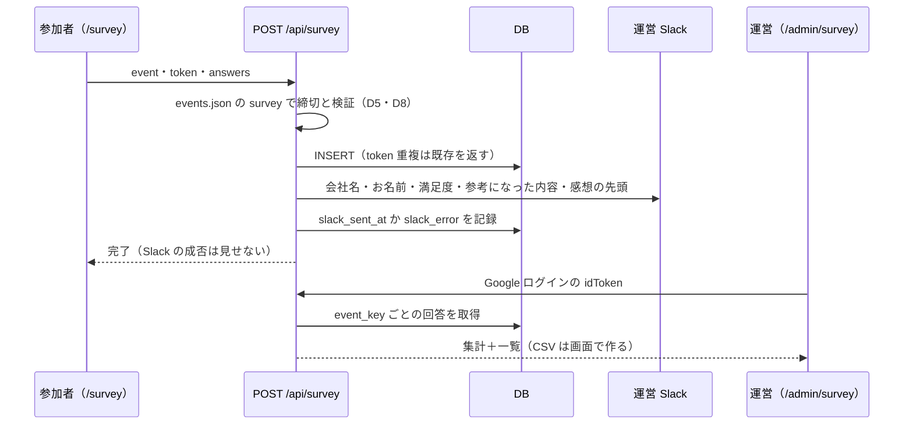

# イベント後の参加者アンケート（関東 Vol.4 から）

状態: 確定
出典: 清野さん 2026-10-22「関東のイベントの後のアンケート作って 参加者用」。設問13問・回答の見方（管理画面に一覧＋集計）・Slack 通知・締切 10/31 は同日の選択で確定
更新: 2026-10-22

## 課題

関東 Vol.4（10/22 ブックオフ出品倉庫 見学会、参加 約20名）の参加者に、満足度・参考になった工程・次回の希望を聞きたい。これまでのアンケートは毎回 Google フォームを手で作り、回答は個人のスプレッドシートに溜まっていた（日程調査 2026-04・FUTURE CONFERENCE 2025）。申込は 10/8 からサイトの DB が正本で、運営は /admin で見ている。アンケートだけがサイトの外にあり、運営が同じ場所で見られない。

## 解決した状態

- 参加者は `/survey?event=kanto-vol4` をスマホで開き、3分で13問に答えられる。10/31 23:59 を過ぎると受付終了と出る
- 回答はサイトの DB に残り、届くたびに運営 Slack に1件ずつ流れる
- 運営は `/admin/survey` で、満足度の平均・選択肢ごとの件数・回答一覧を見て、CSV で持ち出せる
- 関西 Vol.2（12/4）以降は、events.json に設問を書き足すだけで同じページが使える

## 主なコンテキスト

バックエンド。理由：画面に出す設問は確定済み（`関東vol4_事後アンケート_設問案.txt`）。残りは、回答をどの形で持ち、どう検証・通知・集計するか。回答ページと /admin/survey は apply.html・admin.html の見た目と作りに揃える（従）。

## 設計の意図

守るもの：**参加者が答えた内容が、欠けず・ずれずに運営の手元に届くこと。** 設問をイベントごとに変えても、過去の回答の意味が変わらない。

| # | 決めたこと | 意図 | 選ばなかった案 |
|---|---|---|---|
| D1 | 設問はイベントごとに events.json の `survey` に書く（id・文言・種類・必須・選択肢）。ページも API もここから作る | イベントの正本は events.json（申込の D4）。関西 Vol.2 で設問が変わっても、ページ・API・DB を変えずに済む | → 13問を HTML と列に直接書く：イベントのたびに DDL とコードを変える |
| D2 | 回答は1行1回答。答えは `answers`（jsonb、設問 id → 値）に入れる。回答時点の設問定義も `questions`（jsonb）に写して持つ | 設問の文言や選択肢を後で直しても、その回答が何に答えたものかが残る（申込の event_name と同じ時点値の考え） | → 設問ごとに列を持つ：D1 と両立しない／→ 定義を写さない：文言を直すと過去の回答の意味が変わる |
| D3 | 回答者は貴社名・お名前の記入だけで受ける（ログイン・申込との紐づけなし）。同じ人の2回目も別の回答として残す | URL を Slack・メールで配ってすぐ答えられる。会場の QR からも答えられる。申込の名前と完全一致しない（表記ゆれ・代理申込）ので紐づけは運営が目で見る | → 申込ごとの個人 URL：配布に手間がかかり、代理申込の同行者に届かない |
| D4 | 二重送信は申込と同じく送信ごとのトークンで1件にまとめる | 連打・通信の再送で同じ回答が2件にならない（申込の D9） | → 会社名＋名前で重複を弾く：言い直しの再回答まで消える |
| D5 | 検証は API で設問定義に照らして行う。必須・種類・選択肢の範囲・1〜10・文字数（記述 100字、段落 2000字） | 画面を改変されても定義外の値が DB に入らない。集計（D7）が崩れない | → 画面だけで検証：Public なサイトなので API を直接叩かれうる |
| D6 | 保存できたら Slack に1件投稿（清野さんの判断）。失敗しても回答は成立させ、失敗は行に残して /admin/survey に出す。再送はしない | 回答を失わないことが先。申込と違い、届かなくても参加者への影響が無いので Cron の再送までは作らない | → 申込と同じ Cron 再送：20件規模に対して仕組みが重い |
| D7 | /admin/survey は閲覧の許可リスト（ADMIN_EMAILS）で見られる。集計は1〜10の平均と分布、選択式の件数、記述の一覧。CSV は画面にある回答をそのまま書き出す。編集・削除は作らない（清野さんの判断：一覧＋集計） | 運営の誰もが同じ数字を見る。回答は参加者の言葉なので運営が書き換えない | → Neon コンソールで清野さんだけが見る：他の運営が見られない |
| D8 | 締切は `survey.deadline`（2026-10-31）の 23:59:59 JST。過ぎたらページはフォームを出さず、API も受け付けない（清野さんの判断） | 申込の締切判定（isClosed）と同じ規則にして、ページと API で食い違わない | → 締切なし：後から届いた回答で集計が動き続ける |

## アウトプット

**① events.json に足す設問定義（kanto-vol4.survey）**

| 項目 | 値 |
|---|---|
| deadline | `2026-10-31` |
| title / lead | 「ご参加者アンケート」／お礼と所要時間（約3分）の2行（設問案の冒頭文） |
| questions | 設問案の13問。種類は `text`（Q1・Q2）・`scale`（Q3、1〜10）・`checkbox`（Q5）・`radio`（Q8・Q10）・`textarea`（残り）。id は英小文字（例 `company`・`name`・`satisfaction`）。公開後は id を変えない |

**② 新テーブル survey_responses**

| 列 | 型 | 意味 |
|---|---|---|
| id | uuid PK | |
| submission_token | uuid UNIQUE | 送信ごとのトークン（D4） |
| event_key | text | events.json の key |
| answers | jsonb | 設問 id → 値。text/textarea/radio は文字列、scale は整数、checkbox は文字列の配列。任意で空のものは空文字・空配列 |
| questions | jsonb | 回答時点の設問定義の写し（D2） |
| received_at | timestamptz | UTC。表示は JST |
| slack_sent_at | timestamptz | null＝未通知（D6） |
| slack_error | text | 最後の失敗理由 |

本番の DDL は清野さんが Neon のコンソールで流す（運営ボードと同じ）。

**③ 処理の流れ**

**④ 画面**：/survey は apply.html と同じ見た目で縦1列（スマホ前提）。完了後はお礼の文言だけ出す。/admin/survey は申込管理と同じヘッダーにタブ「アンケート」を足し、イベントごとのタブで集計→一覧の順に並べる。

## ユースケース

| # | 場面 | 入力・条件 | 期待する結果 |
|---|---|---|---|
| U1 | 通常 | 10/22 17:00、全13問に回答して送信 | 200。1行保存、answers に13個。Slack に1件。完了画面 |
| U2 | 任意を空 | 必須6問（Q1・Q2・Q3・Q5・Q8・Q10）だけ回答 | 200。任意は空文字・空配列で保存 |
| U3 | 必須漏れ | Q5 を1つも選ばない | 400「必須項目が入力されていません」。保存しない |
| U4 | 範囲外 | satisfaction=11、または Q8 に定義外の文字列 | 400。保存しない |
| U5 | 長すぎ | 感想 2001字 | 400。2000字は通る |
| U6 | 二重送信 | 同じ token で2回 POST | 2回目も 200、行は1件、Slack も1件 |
| U7 | 締切 | 2026-10-31 23:59:58 JST と 23:59:59 JST に送信 | 前者は 200、後者は 400 code=closed。締切後のページはフォームを出さず受付終了を表示 |
| U8 | アンケート無し | event=kansai-vol2（survey 未定義）・未知の key | ページは「対象のアンケートが見つかりません」。API 400 |
| U9 | Slack 失敗 | Slack API がエラー | 200。行は保存、slack_error に理由。/admin/survey に「通知失敗」 |
| U10 | 集計 | 満足度 8・10・9 の3件、Q5 でピッキング2件 | 平均 9.0、分布、ピッキング 2件と表示。CSV に3行＋ヘッダー |
| U11 | 権限 | ADMIN_EMAILS に無いアカウント | 403。回答は見えない |
| U12 | 設問を後で直す | 回答後に Q8 の選択肢の文言を変更 | 既存の回答は questions の写しで元の文言のまま表示 |

## 未確定事項

| 項目 | 誰に聞くか | 期限 | 回答 |
|---|---|---|---|
| 配り方（参加者チャンネル・メール・会場の QR） | 清野さん（運用。実装は止めない） | 10/22 公開時 | |

## 差し戻し
